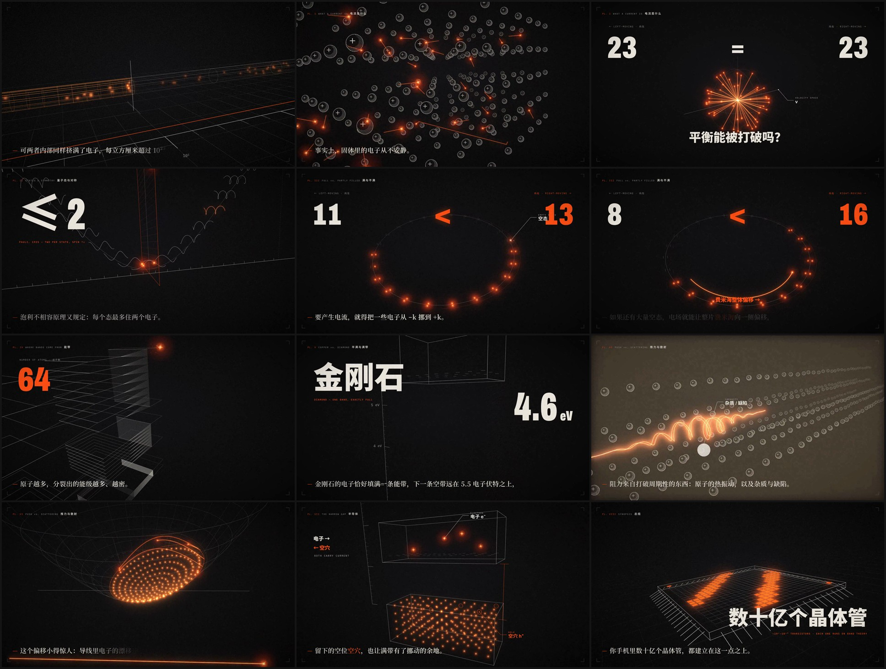

# 量子力学如何解释导电性 · Remotion 项目

1920×1080 · 30 fps · 3 分 37 秒 · 简体中文字幕 · 无音轨



## 版本

| 版本 | 日期 | 说明 | 成片 |
| --- | --- | --- | --- |
| v1.0.0 | 2026-10-13 | 首个交付版：九幅图版，3 分 37 秒，黑底版画风格 + 仿辉光 | [Release](../../releases/tag/v1.0.0) |

详细变更见 [CHANGELOG.md](CHANGELOG.md)。开发过程中的风格预览留在 `docs/`（`style-preview-early.jpg`、`style-preview-v3.jpg`），只作参考，对应的旧工程没有保留。

### 版本怎么管

- 每个交付版本打一个 tag（`v1.0.0`、`v1.1.0`……），对应的成片、字幕、旁白稿和关键帧挂在同名的 GitHub Release 上。不同版本并列保存，随时可以拿任意一版来展示。
- 改版在分支上做（例如 `revise/字幕节奏`），确认后合并回 `main` 并打新 tag。
- 取回某一版的工程重新渲染：

```bash
git checkout v1.0.0
npm install
npm run render
```

## 快速开始

```bash
npm install
npm run studio      # 浏览器里预览、逐帧拖动
npm run render      # 导出 out/quantum-conductivity.mp4
npm run subtitles   # 导出 out/subtitles.srt 和 out/narration.md（旁白稿）
```

## 美术方向

参考 mexicat/pdoom-video（MIT）的视觉语言：一本「论导电」小论文里的八幅图版，全部为黑底。

- **配色**：墨黑 `#0A0A0B`、骨白 `#EEE9DF`、灰烬 `#9C978F`，加唯一的信号橙 `#FF4D12`（余烬 / 血红只作橙色的明暗）。
- **一个主角**：每个镜头只有一个运动主体（一颗火花、一束波、一座轨道塔、一张能带曲面），其余信息是挂在它身上的小标注。
- **纵深**：`src/engine/space.tsx` 是一个轻量透视引擎（Canvas2D，不用 WebGL）：相机 eye→target、近大远小的线宽、按距离雾化、版画式球体、曲面线框。
- **火花**：电子 = 白热内核 + 橙色光晕 + 迸溅粒子（移植自参考仓库的 `sparkHead` / `sparkParticles`），只有它会发光。
- **仿辉光**：发光层缩小→两级模糊→叠加回画面；常态约 0.35–0.55，关键镜头（撞击、散射、拒绝、导通、热激发、芯片）脉冲到 1 以上。用 `bloomAt(f, 常态, [关键帧…], 强度, 半衰期)` 调。
- **动效**：图版间硬切；outExpo 急停、inOutExpo 甩镜头（甩动时开启子帧运动模糊）、撞击时震屏。
- **大字**：整屏字块砸入（`Slam`）、里程表式滚动数字（`Roller` / `StepRoller`），代替小标签。

## 改文案

所有字幕在 `src/script.ts` 的 `SCENES` 里。每条字幕时长按字数自动计算（`SEC_PER_CHAR`，默认约 5.5 字/秒），改文字后时间轴自动重排，动画跟着字幕走。

- `「关键词」` 在画面上以信号橙高亮。
- 想放慢节奏配旁白：调大 `SEC_PER_CHAR`（例如 0.22 ≈ 4.5 字/秒）。
- 录好旁白后可按 `out/narration.md` 里的时间码对齐。

## 叙事

先讲对称性与量子态，再讲能带，最后讲推力与散射的平衡：

1. **开场** 铜与玻璃电阻率相差 20 多个数量级，可两者电子一样多。
2. **电流是什么** 电子本来就以约 1600 km/s 乱窜；电流 = 速度分布不对称（Σv ≠ 0）。
3. **量子态与对称** 电子是波，住在 E(k) 上的态里；对称性让 +k 与 −k 成对；泡利填充；平衡时净电流为零。
4. **满与不满** 布里渊区首尾相接成环：满带整体挪一格等于没变（绝缘体）；有空态时费米海偏移（金属）。
5. **能带** 能级分裂成带，带与带之间是带隙。
6. **半满与满带** 铜半满；金刚石满带 + 5.5 eV 带隙，室温 0.025 eV 跳不过去。
7. **推力与散射** 完美晶格不散射；声子和杂质把费米海前沿打回后沿 → 稳态 = 欧姆定律；漂移速度 < 1 mm/s，约为费米速度的 10⁻¹⁰；温度越高电阻越大。
8. **半导体** 窄带隙、空穴、掺杂。
9. **总结** 区别在于有没有空着的量子态。

## 结构

| 文件 | 内容 |
| --- | --- |
| `src/script.ts` | 文案 + 时间轴 + 图版标题 |
| `src/engine/space.tsx` | 透视引擎、火花/球体/曲面、辉光 |
| `src/engine/fx.tsx` | 火花、迸溅粒子、发光线（Canvas2D） |
| `src/engine/type.tsx` | 砸入字块、滚动数字、引线标注 |
| `src/engine/camera.tsx` | 运动模糊开关等 |
| `src/engine/util.ts` | 缓动、噪声、关键帧（移植自参考仓库，MIT） |
| `src/scenes/S1Hook.tsx` | 开场 + 标题 |
| `src/scenes/SCurrent.tsx` | 电流是什么：实空间乱窜 → 速度空间的“星” |
| `src/scenes/SStates.tsx` | 量子态与对称：螺旋平面波 → E(k) 上的座位、镜面、泡利填充 |
| `src/scenes/SFill.tsx` | 满与不满：E(k) 弯成环；满环转一格不变；半满环偏移 |
| `src/scenes/S4Bands.tsx` | 能带：能级沿纵深逐级分裂；镜头钻进带隙 |
| `src/scenes/SGaps.tsx` | 铜的半满能带；金刚石 5.5 eV 升降镜头；放大 kT |
| `src/scenes/SScatter.tsx` | 推力与散射：费米海失控 → 实空间散射 → 前沿打回后沿的稳态 → 10⁻¹⁰ → ρ(T) |
| `src/scenes/S8Semi.tsx` | 半导体：热激发、空穴、掺杂晶格 |
| `src/scenes/S9Summary.tsx` | 三种材料并排、发光芯片、结尾卡 |

## 字体与素材（SIL Open Font License 1.1）

- 思源黑体 / 思源宋体（Noto Sans / Serif CJK SC），裁剪到 GB2312 常用字。
- Archivo、IBM Plex Mono、Cormorant Garamond（拉丁字母、数字、公式）。
- `public/tex/` 下的颗粒贴图由脚本生成。

## 关键数据（已核对）

- 铜电阻率 ≈ 1.7×10⁻⁸ Ω·m；石英玻璃 > 10¹⁶ Ω·m
- 铜中电子平均自由程 ≈ 40 nm（室温）；最近邻原子间距 ≈ 0.26 nm
- 铜的费米速度 ≈ 1.57×10⁶ m/s（约光速的 1/190）；1 A/mm² 时铜中漂移速度 ≈ 0.07 mm/s（比值约 10⁻¹⁰–10⁻¹¹）
- 带隙：金刚石 ≈ 5.5 eV，硅 ≈ 1.12 eV；室温 k_BT ≈ 0.025 eV（约为金刚石带隙的 1/220）
- 德鲁德模型 1900；德布罗意物质波 1924；泡利不相容原理 1925；布洛赫定理 1928

画面中的电子数量、费米圆偏移幅度等为示意，做了夸张处理。

第三方代码（移植自 mexicat/pdoom-video，MIT）和字体许可证见 [THIRD_PARTY_NOTICES.md](THIRD_PARTY_NOTICES.md)。
